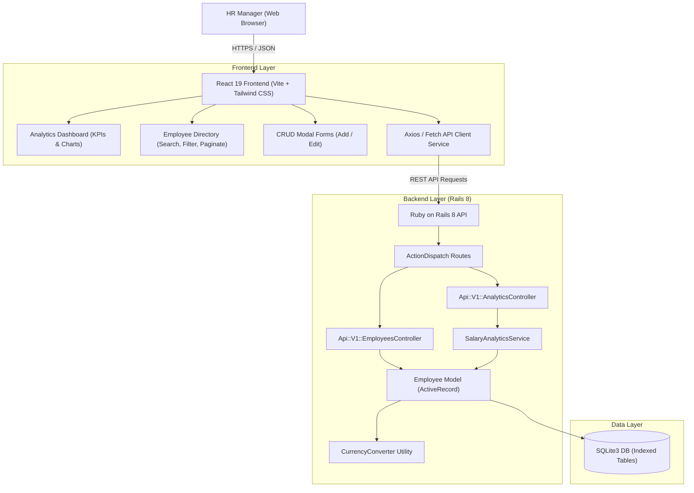

# Architecture & Technical Design Document

## 1. System Overview
The **ACME Employee Salary Management System** is built on a clean decoupled architecture:
* **Backend:** Ruby on Rails 8 (API mode) providing RESTful JSON endpoints, business logic services, and database-level aggregations.
* **Frontend:** React 19 (Vite) Single Page Application delivering an interactive, responsive dashboard and employee grid with Tailwind CSS and Lucide icons.
* **Database:** SQLite 3 configured with Write-Ahead Logging (WAL) and composite B-tree indexes for fast analytical aggregations and sub-millisecond lookups.



---

## 2. Database Schema Design

### `employees` Table
| Column | Type | Constraints / Modifiers | Description |
| :--- | :--- | :--- | :--- |
| `id` | integer | PRIMARY KEY, AUTOINCREMENT | Unique employee identifier |
| `first_name` | varchar | NOT NULL | Employee given name |
| `last_name` | varchar | NOT NULL | Employee family name |
| `email` | varchar | NOT NULL, UNIQUE | Unique corporate email address |
| `job_title` | varchar | NOT NULL | Role/designation (e.g., Senior Software Engineer) |
| `department` | varchar | NOT NULL | Department (Engineering, Sales, etc.) |
| `country` | varchar | NOT NULL | Work jurisdiction (US, UK, DE, IN, SG) |
| `currency` | varchar(3) | NOT NULL | ISO 4217 Currency (USD, GBP, EUR, INR, SGD) |
| `annual_salary` | decimal(12, 2) | NOT NULL, CHECK (annual_salary > 0) | Base annual salary in local currency |
| `joined_date` | date | NOT NULL | Date employee joined the company |
| `created_at` | datetime | NOT NULL | System audit timestamp |
| `updated_at` | datetime | NOT NULL | System audit timestamp |

### Database Indexes
* `index_employees_on_email` (UNIQUE): Fast lookups and duplicate prevention.
* `index_employees_on_department`: Instant filtering and group-by aggregations.
* `index_employees_on_country`: Fast regional slicing.
* `index_employees_on_annual_salary`: Efficient salary range searches and percentiles.
* `index_employees_on_last_name_and_first_name`: Accelerated alphabetical sorting and name searching.

---

## 3. API Contract Specifications

### 3.1. Analytics Overview
* **Endpoint:** `GET /api/v1/analytics/overview`
* **Response:**
```json
{
  "summary": {
    "total_employees": 10000,
    "total_payroll_usd": 894520340.0,
    "average_salary_usd": 89452.03,
    "median_salary_usd": 85000.0,
    "min_salary_usd": 25000.0,
    "max_salary_usd": 240000.0
  },
  "department_breakdown": [
    {
      "department": "Engineering",
      "headcount": 3200,
      "total_payroll_usd": 352000000.0,
      "average_salary_usd": 110000.0,
      "min_salary_usd": 55000.0,
      "max_salary_usd": 240000.0
    }
  ],
  "country_breakdown": [
    {
      "country": "United States",
      "country_code": "US",
      "currency": "USD",
      "headcount": 3500,
      "total_payroll_usd": 420000000.0,
      "average_salary_usd": 120000.0
    }
  ],
  "salary_bands": [
    { "range": "$0 - $50k", "count": 1850 },
    { "range": "$50k - $100k", "count": 4200 },
    { "range": "$100k - $150k", "count": 2750 },
    { "range": "$150k - $200k", "count": 950 },
    { "range": "$200k+", "count": 250 }
  ]
}
```

### 3.2. Employee Listing with Pagination & Search
* **Endpoint:** `GET /api/v1/employees`
* **Query Parameters:**
  * `page` (integer, default 1)
  * `per_page` (integer, default 25, max 100)
  * `search` (string, matches name, email, job title)
  * `department` (string, optional filter)
  * `country` (string, optional filter)
  * `sort_by` (field: `name`, `annual_salary`, `joined_date`, `department`, `country`)
  * `sort_order` (`asc` | `desc`)
* **Response:**
```json
{
  "employees": [
    {
      "id": 1,
      "first_name": "Jane",
      "last_name": "Doe",
      "email": "jane.doe@acme.org",
      "job_title": "Staff Software Engineer",
      "department": "Engineering",
      "country": "United States",
      "currency": "USD",
      "annual_salary": 185000.0,
      "annual_salary_usd": 185000.0,
      "joined_date": "2021-03-15"
    }
  ],
  "pagination": {
    "current_page": 1,
    "per_page": 25,
    "total_pages": 400,
    "total_count": 10000
  }
}
```

### 3.3. Employee Mutation Endpoints
* `POST /api/v1/employees` -> Creates employee with status 201 or 422 with validation errors.
* `GET /api/v1/employees/:id` -> Returns employee details.
* `PATCH /api/v1/employees/:id` -> Updates employee fields.
* `DELETE /api/v1/employees/:id` -> Removes employee, returns 204 No Content.

---

## 4. Frontend Component Hierarchy
```
App
├── Navbar (App Branding, System Status, HR Manager Persona)
├── TabBar (Overview Analytics vs. Employee Directory)
├── AnalyticsDashboard (View 1)
│   ├── KPIStatsCards (Total Headcount, Total Payroll, Avg Salary, Median Salary)
│   ├── DepartmentBreakdownChart (Horizontal Bar & Spend Metrics)
│   ├── CountryBreakdownChart (Geographical Spend & Headcount)
│   └── SalaryBandHistogram (Distribution Across Pay Tiers)
└── EmployeeDirectory (View 2)
    ├── FilterBar (Search Input with Debounce, Country Select, Dept Select, Reset)
    ├── EmployeeTable (Sortable Columns, Localized & USD Salaries, Action Buttons)
    ├── PaginationControls (Page Numbers, Per Page Select, Jump to Page)
    ├── AddEmployeeModal (Form with live validation)
    └── EditEmployeeModal (Form prefilled with employee data)
```
